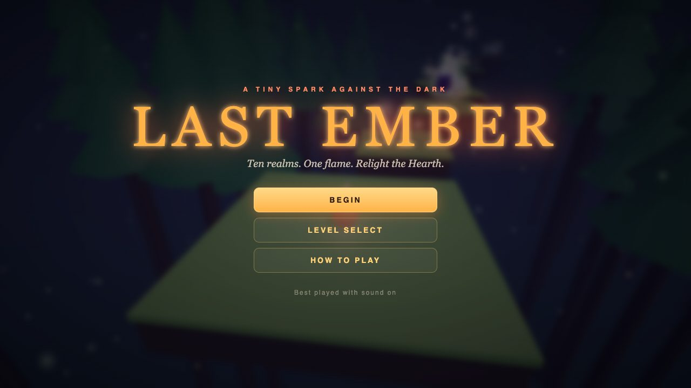
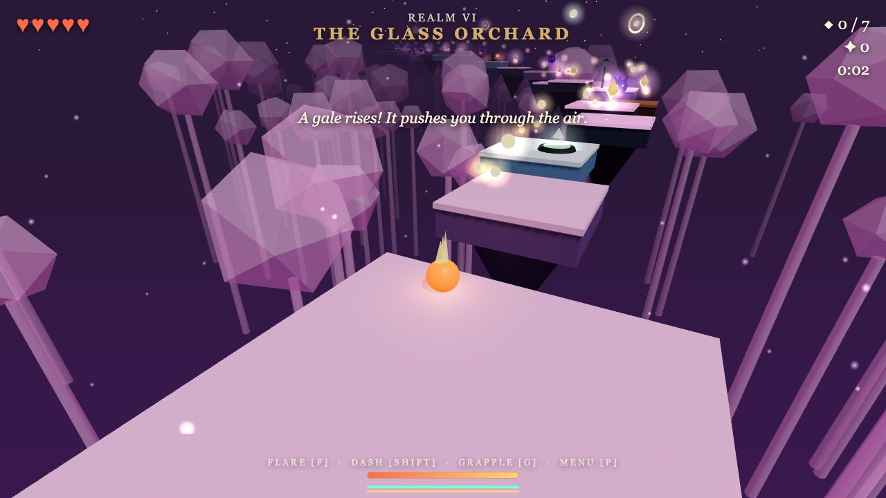
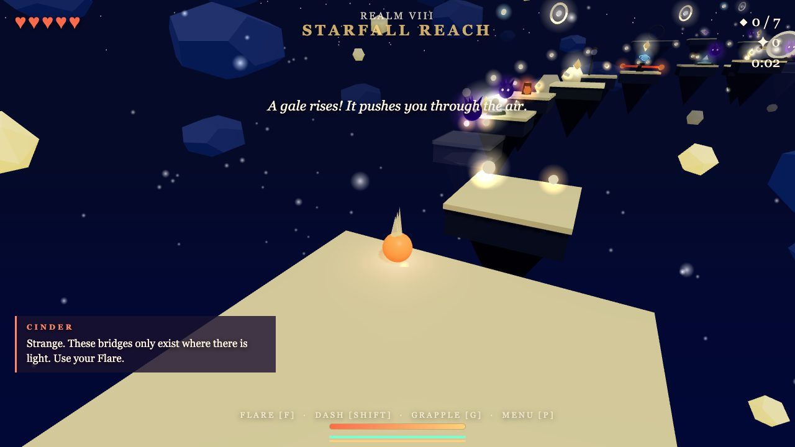
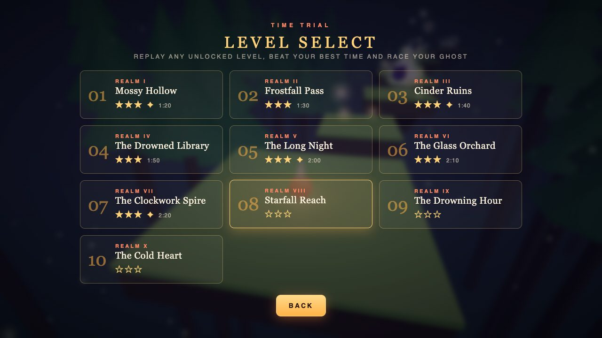

# Last Ember

A 3D platformer that runs in your browser. You are Ember, the last spark in a world gone cold. Cross ten forgotten realms, gather the shards of the Hearth and relight it.

**[Play it here](https://philjay.github.io/last-ember/)**



## The story

The Hearth once burned at the center of the world. Then the Gloom came, a creeping dark that drinks light. The Hearth shattered into shards and went out, and the shards were scattered across ten forgotten realms.

You are Ember, the last spark, no bigger than a thought. Cinder, a small voice inside you, guides you with hints in every realm. Gather the shards, and relight the Hearth. Along the way you find pages from the diary of the Keeper, who tended the Hearth. Find every page for a bonus line in the ending.

## The ten realms

| # | Realm | What it does to you |
|---|---|---|
| 1 | Mossy Hollow | A gentle forest to learn the basics |
| 2 | Frostfall Pass | Slippery ice |
| 3 | Cinder Ruins | Lava and crumbling ground |
| 4 | The Drowned Library | Lightning storms and moving platforms |
| 5 | The Long Night | Rising Gloom that chases you upward |
| 6 | The Glass Orchard | Strong wind and bridges that only exist in your light |
| 7 | The Clockwork Spire | Spinning blades and steam geysers |
| 8 | Starfall Reach | Huge gaps that need glide and grapple, and fading platforms |
| 9 | The Drowning Hour | A faster flood with crumbling and fading ground |
| 10 | The Cold Heart | The longest level, ending in a boss fight |

Gaps get wider, hazards get denser and the chase levels get faster as you go.



## How to play

Collect the shards and reach the portal at the end of each realm. You have five hearts. Touch the Gloom or fall and you lose one and respawn.

| Action | Keyboard | Gamepad | Touch |
|---|---|---|---|
| Move | WASD or arrows | Left stick | On-screen stick |
| Jump, then jump again | Space | A | Button |
| Glide | Hold Space after the double jump | Hold A | Hold button |
| Dash | Shift or Q | B or RB | Button |
| Flare | F, E or click | X or LB | Button |
| Grapple | G | Y | Button |
| Rotate camera | Mouse drag, Z, X | Right stick | Drag |
| Tilt camera | R, V | Right stick | Drag |
| Zoom | Wheel, + and - | Triggers | Pinch |
| Pause menu | P or Esc | Start | Button |
| Mute | M | | |

**Flare** burns the Gloom, wakes light bridges and hurts the boss. **Grapple** zips you to the golden ring you are facing. **Dash** burns through wisps and can only be used once per air time.

## What you find along the way

- **Shards**: pieces of the Hearth. Collect them all in a realm for a better rating, and carry the last ones to the final Hearth.
- **Embers**: small pickups that add to your score.
- **Diary pages**: one hidden in each realm, often on a secret side platform. They tell the Keeper's story and add to the ending.
- **Lanterns and bounce pads**: lanterns light your way, pads launch you upward.
- **Power-ups**: shield, speed, moon (floatier jumps) and magnet (pulls pickups to you).
- **Challenge courses**: optional trials with a Golden Flame reward.
- **Ghost**: your best run is recorded, and you can race it when you replay a level.
- **Stars and times**: each level has a par time and a three-star rating.



## Level select

Every cleared realm unlocks the next. You can replay any unlocked realm, start a time trial, and see your stars and best time.



## Run it locally

```
./start.sh
```

Then open http://localhost:5173. Any static file server works, for example `python3 -m http.server 5173`.

## Tech

- Three.js (bundled in `vendor/three`), no build step
- Hand-written platformer physics with coyote time, jump buffering and moving-platform carry
- Levels generated from a seeded random number generator, so each realm is the same every time
- Sound and music are synthesized with the Web Audio API, so there are no audio files
- Progress, best times and ghosts are stored in your browser (localStorage)

## Files

- `index.html`: page, menus and styles
- `src/main.js`: game loop, player, input, hazards, boss and menus
- `src/world.js`: level generation and all 3D objects
- `src/levels.js`: realm settings and all story text
- `src/audio.js`: sound effects and music
